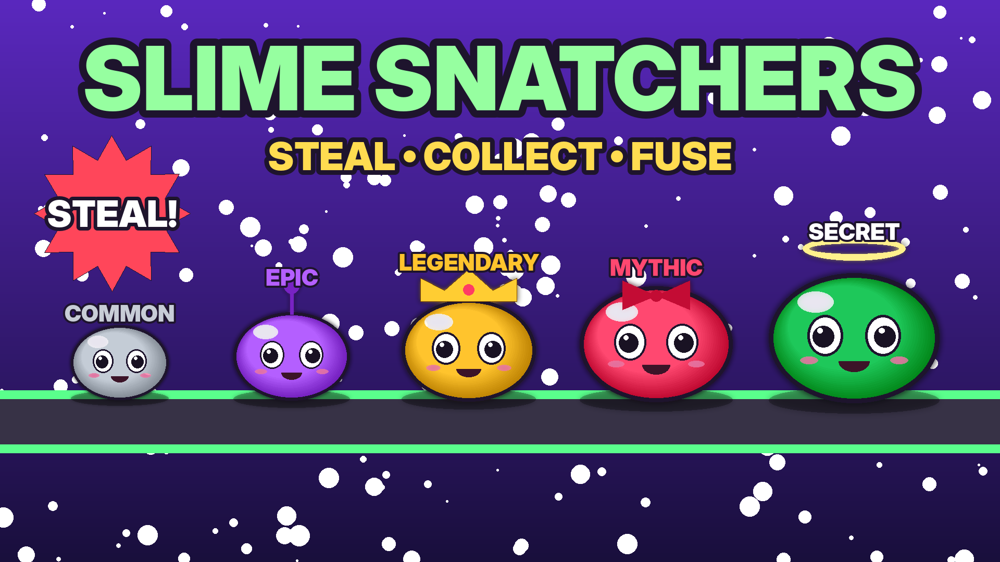

# 🟢 Slime Snatchers — game Roblox siap publish

Game **steal-tycoon** orisinal (genre #1 di Roblox saat ini — lihat [riset](docs/RISET-DAN-KALKULASI.md)):
beli slime dari conveyor, slime menghasilkan cash di base-mu, curi slime pemain lain, pukul pencuri
dengan Bonk Hammer, kunci base, fuse 3 slime jadi mutasi langka, dan rebirth untuk pengali besar.



## Mulai dalam 5 langkah
1. Buka `build/SlimeSnatchers.rbxlx` di **Roblox Studio** (File → Open from File) → tekan Play.
2. **File → Publish to Roblox As…** → buat experience baru.
3. Game Settings: *Enable Studio Access to API Services*, **Max Players = 8**, Avatar **R15**.
4. Buat Game Pass & Developer Product di Creator Hub (nama, harga, deskripsi siap copy-paste di
   [docs/PANDUAN-SETUP.md](docs/PANDUAN-SETUP.md)) → tempel ID-nya di
   `ReplicatedStorage › Shared › Config` → Publish.
5. Upload `marketing/icon.png` + `marketing/thumbnail.png`, isi deskripsi dari
   [docs/LAUNCH-DAN-MARKETING.md](docs/LAUNCH-DAN-MARKETING.md), set Public.

## Isi game
| Sistem | Detail |
|--------|--------|
| Core loop | Conveyor "Slime Pipe" memunculkan slime tiap 2,3 dtk → beli (cash) → slime di pad menghasilkan cash → injak pelat hijau untuk ambil |
| Koleksi | 24 slime orisinal, 8 rarity (Common → **Secret**), 5 mutasi (Golden x2, Diamond x3, Rainbow x5, Galaxy x10), Index (+1% cash per jenis) |
| Progres | Slime naik level sendiri (s/d Lv 10, x2,35 income), Fuse 3→1 mutasi lebih tinggi, Rebirth (+0,5x cash & +2 pad, slime tetap) |
| Sosial | Mencuri (hold E), dibawa di atas kepala, Bonk Hammer, kunci base 60 dtk, bonus teman +5%, leaderboard global |
| Event | Lucky Hour, Golden Hour, Slime Rain, Goo Moon (semua kunci mati!) + admin event dari panel 🛠️ |
| Retensi | Daily streak 7 hari, 8 hadiah playtime, 3 quest harian, kode, offline earnings, tutorial interaktif |
| Monetisasi | 7 game pass, cash pack yang menyesuaikan income, server luck/rain (dibeli untuk semua), shield, Starter Pack, instant-buy slime yang terlihat, gifting, rewarded video ads, Roblox Plus bonus, experience subscription |
| Teknis | Data dengan session-lock & anti double-grant (ProcessReceipt), server-authoritative + rate limit, UI mobile-first dibuat dari kode, map dibangun otomatis, analytics Creator Hub |

Tidak ada item acak berbayar; peluang spawn selalu ditampilkan (menu 🎲 Odds) sesuai kebijakan Roblox.

## Struktur
```
slime-snatchers/
├── build/SlimeSnatchers.rbxlx      ← file place siap buka di Studio
├── default.project.json            ← proyek Rojo (opsional)
├── src/
│   ├── ReplicatedStorage/Shared/   ← Config (EDIT INI), data slime, rumus ekonomi, model slime
│   ├── ServerScriptService/        ← Main + 14 service server
│   └── StarterPlayerScripts/Client/← UI, efek, tutorial, panel toko dll.
├── marketing/                      ← icon.png, thumbnail.png
├── docs/                           ← riset, kalkulasi, panduan setup, rencana launch
└── tools/                          ← checker Luau, builder .rbxlx, generator gambar
```

## Mengubah game
- Harga, ID produk, kode, bonus, kecepatan spawn, durasi lock: `src/ReplicatedStorage/Shared/Config.luau`
- Slime (nama, harga, income, warna, aksesori): `Slimes.luau` · peluang rarity: `Rarities.luau`
- Setelah mengedit file di `src/`, bangun ulang place: `python3 tools/build_place.py default.project.json -o build/SlimeSnatchers.rbxlx`
  (atau edit langsung di Studio).

## Dokumen
- [Riset top 10 & kalkulasi $1.000/bulan](docs/RISET-DAN-KALKULASI.md)
- [Kalkulator pendapatan interaktif (buka di browser)](docs/kalkulator-pendapatan.html)
- [Panduan setup langkah demi langkah](docs/PANDUAN-SETUP.md)
- [Launch & marketing 30 hari](docs/LAUNCH-DAN-MARKETING.md)
- [Tools verifikasi](tools/README.md)
